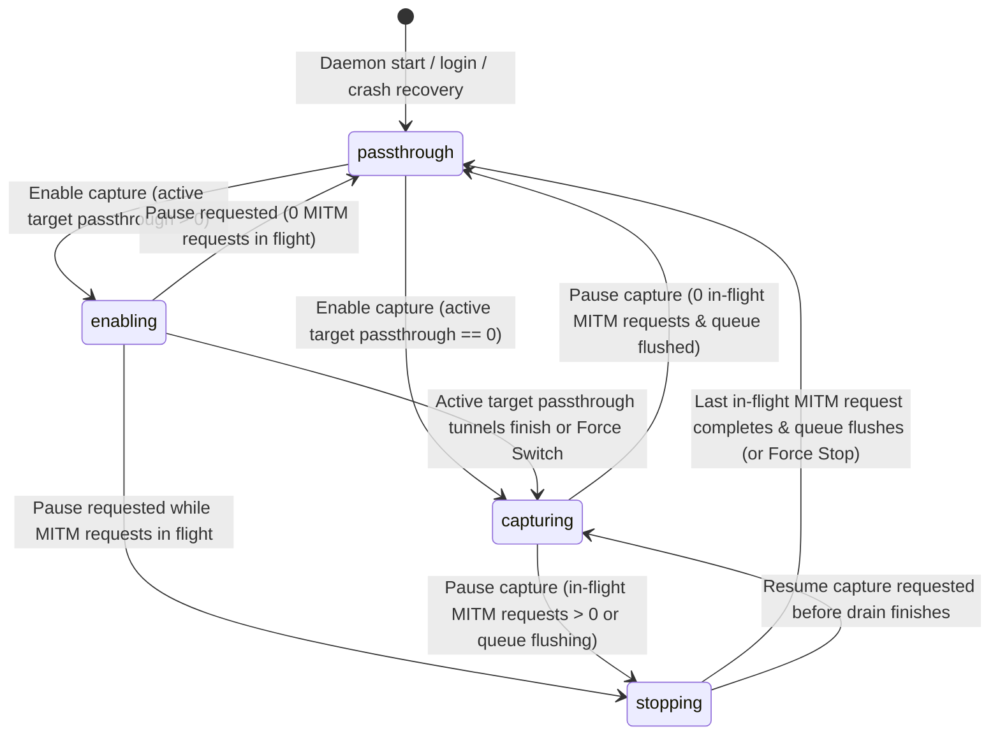

# Langley Daemon & Truthful Capture State Specification

## 1. Core Principles

1. **Dormant by Default:** Every daemon start, login, reboot, or crash recovery begins in **`passthrough`** mode. Capture (`capturing`) is never persisted across daemon restarts by default; decrypting and storing traffic always requires an explicit user action during the current daemon lifetime.
2. **Truthful State Labels:**
   - In **`passthrough`**: TLS payloads are **not** decrypted, parsed, or stored. The proxy only reads the initial HTTP `CONNECT host:port` header to open a raw TCP tunnel.
   - The UI and CLI never display **`passthrough`** while any previously intercepted MITM connection is still being decrypted, parsed, or flushed to SQLite (`stopping` is shown instead).
   - Turning capture **ON** never aborts an active in-flight stream on an existing passthrough tunnel; idle passthrough tunnels to target hosts are closed immediately, while active tunnels drain and switch after their current turn completes (with an explicit **Force Switch** option).
3. **Scoped Interception & Safe Trust Bundle:**
   - Only hosts matching `intercept_hosts` (e.g. `api.anthropic.com`, `api.openai.com`, `generativelanguage.googleapis.com`) are ever eligible for MITM when capture is enabled. All other hosts (`github.com`, `registry.npmjs.org`, etc.) **always** use raw TCP passthrough.
   - `NODE_EXTRA_CA_CERTS` points to `ca.crt` (additive trust in Node.js).
   - `SSL_CERT_FILE` and `REQUESTS_CA_BUNDLE` point to a generated **`ca-bundle.pem`** (`System Root CAs + Langley CA`) so Python/OpenSSL/curl continue to trust standard public CAs on passthrough and non-target connections.

---

## 2. Two-Dimensional State Model

### 2.1 Daemon State
| State | Meaning |
|---|---|
| `stopped` | No verified Langley daemon process is listening. |
| `running` | Verified Langley daemon (`service: "langley"`, matching `instance_id` and live `pid`) is listening on `127.0.0.1:<proxy>` and `127.0.0.1:<api>`. |

### 2.2 Traffic / Capture State Machine (when Daemon is `running`)



| Capture State | Proxy Behavior on New `CONNECT` | Existing Connections | UI / CLI Status Label |
|---|---|---|---|
| **`passthrough`** | Raw TCP tunnel for all hosts. TLS payloads are not decrypted, parsed, or stored. | Only raw TCP tunnels exist (`active_mitm_requests == 0`, persistence queue idle). | `Passthrough — TLS payloads are not decrypted, parsed, or stored` |
| **`enabling`** | Target hosts (`intercept_hosts`) are MITM-intercepted; non-target hosts tunnel untouched. | Idle target passthrough tunnels were closed immediately; `draining_passthrough_tunnels > 0` active tunnels are finishing their current transfer before closing on idle. | `Capturing (N active connection(s) will switch after current request)` + `[Force switch now]` |
| **`capturing`** | Target hosts (`intercept_hosts`) are MITM-intercepted; non-target hosts tunnel untouched. | `draining_passthrough_tunnels == 0`. All target connections are MITM-intercepted. | `Capturing — intercepting configured LLM hosts` |
| **`stopping`** | Raw TCP tunnel for all new `CONNECT` requests immediately. | Idle MITM keep-alive sockets closed immediately; `draining_mitm_requests > 0` in-flight MITM requests/streams are finishing and flushing to SQLite, then their sockets close. | `Stopping capture — finishing N active request(s)…` + `[Abort active requests]` |

### 2.3 Connection Draining Mechanics
- **Passthrough → Capture (`enabling` → `capturing`):**
  - The proxy tracks open passthrough tunnels whose `host` matches `intercept_hosts`, recording `lastActivity` timestamps on every directional byte copy.
  - When capture is enabled:
    1. Any target passthrough tunnel idle for `>= 500ms` is closed immediately so the client's HTTP keep-alive pool reconnects through MITM on its next request.
    2. Any target passthrough tunnel with active traffic (`< 500ms` since last byte) is marked `closeOnIdle`: as soon as no bytes flow in either direction for `500ms` (end of the current response turn), the proxy closes the tunnel so the next prompt reconnects through MITM.
    3. Clicking **Force switch now** (or `langley --force`) closes remaining `closeOnIdle` target passthrough tunnels immediately.
- **Capture → Passthrough (`stopping` → `passthrough`):**
  - In MITM mode (`internal/proxy/mitm.go`), Langley demarcates individual HTTP request/response lifecycles on each TLS connection:
    1. Idle MITM keep-alive connections (not currently between request start and response/SSE completion) are closed immediately when pause is requested.
    2. In-flight MITM requests (`draining_mitm_requests > 0`) complete their current response body / SSE stream, flush their flow/events to SQLite, and immediately close their client+upstream TLS sockets so no subsequent request can reuse that decrypted connection.
    3. Clicking **Abort active requests** (or `langley pause --force`) immediately closes in-flight MITM sockets, flushes partial flow state, and transitions to `passthrough`.

---

## 3. CLI Command Surface

| Command | Behavior |
|---|---|
| `langley` | Ensures the background daemon is running, enables capture (`capturing`/`enabling`), opens the dashboard (`http://127.0.0.1:<api>`), prints status + bound addresses, and exits `0` immediately. (`--force` closes active target passthrough tunnels immediately; `--no-browser` skips opening the browser; `--foreground` runs the daemon in the foreground without detaching.) |
| `langley pause` | Transitions capture to `passthrough` (entering `stopping` until in-flight MITM requests finish and flush, or immediately with `langley pause --force`). Does **not** stop the daemon or dashboard. |
| `langley dashboard` | Ensures the background daemon is running and opens `http://127.0.0.1:<api>` **without** changing capture state (remains in `passthrough` if currently paused). |
| `langley status` | Prints daemon state (`running`/`stopped`), capture state (`passthrough`/`enabling`/`capturing`/`stopping`), active/draining connection counts, bound proxy/API addresses, and configured `intercept_hosts`. |
| `langley daemon <start\|stop\|restart\|status>` | Explicitly starts, stops, restarts, or queries the background daemon process / OS service (`LaunchAgent` on macOS, `systemd --user` on Linux). Restarting always starts in `passthrough`. |
| `langley setup` | 1. Generates CA (`ca.crt`, `ca.key`) and installs `ca.crt` in the system trust store.<br/>2. Builds combined **`ca-bundle.pem`** (`System Root CAs + Langley CA`).<br/>3. Installs and starts the user-level daemon service (`LaunchAgent` / `systemd --user`) in `passthrough` mode.<br/>4. Installs the guarded shell hook in `.zshrc` / `.bashrc`. |
| `langley uninstall` | Complete recovery path:<br/>1. Stops the daemon and removes the `LaunchAgent` / `systemd --user` unit.<br/>2. Removes the managed shell hook block from `.zshrc` / `.bashrc` (restoring backups) and deletes `shell.env` / `active.env`.<br/>3. Removes the Langley CA from the system trust store.<br/>4. Removes generated certificates, private key, and runtime state (`--keep-data` preserves `langley.db` if desired). |

---

## 4. Shell Integration, Port Conflicts & Instance Identity

1. **Dynamic Port & Identity Verification (`shell.env`):**
   - When the daemon starts, it binds `127.0.0.1:9090` (proxy) and `127.0.0.1:9091` (API/dashboard), falling back to the next available loopback port if `9090` or `9091` is occupied by another program.
   - `GET /api/health` returns:
     ```json
     {
       "status": "ok",
       "service": "langley",
       "instance_id": "<uuid>",
       "pid": 12345,
       "proxy_addr": "127.0.0.1:9090",
       "api_addr": "127.0.0.1:9091",
       "capture_state": "passthrough"
     }
     ```
   - The daemon writes `~/.config/langley/shell.env` containing the actual bound `proxy_addr`, `ca.crt` (for `NODE_EXTRA_CA_CERTS`), `ca-bundle.pem` (for `SSL_CERT_FILE` and `REQUESTS_CA_BUNDLE`), `NO_PROXY='localhost,127.0.0.1,::1,.local'`, and the daemon's `pid`.
2. **Guarded `.zshrc` / `.bashrc` Snippet:**
   - On shell startup and prompt (`_langley_sync`), the shell hook checks `shell.env`:
     - If `kill -0 <daemon_pid>` succeeds, it exports `HTTPS_PROXY`, `HTTP_PROXY`, `NO_PROXY`, `NODE_EXTRA_CA_CERTS`, `SSL_CERT_FILE`, and `REQUESTS_CA_BUNDLE` using the daemon's verified port and combined bundle.
     - If `kill -0 <daemon_pid>` fails (e.g., daemon was stopped via `langley daemon stop` or binary was removed), `_langley_sync` **unsets** `HTTPS_PROXY`/`HTTP_PROXY` and CA env vars in the shell so the terminal never points at a dead port.

---

## 5. Control-Plane Security & Web UI

1. **Loopback Binding + Origin/Host/Token Verification:**
   - Proxy and API servers bind to `127.0.0.1` by default (never `0.0.0.0` unless explicitly configured).
   - API middleware validates:
     - `Host` header matches the bound loopback `api_addr` (`127.0.0.1:<port>` or `localhost:<port>`) to block DNS rebinding attacks.
     - `Origin` header (when present on HTTP requests or `/ws` upgrades) matches `http://127.0.0.1:<port>` or `http://localhost:<port>` (or configured CORS origins) to block cross-origin browser requests from arbitrary websites.
     - Bearer token authentication (`LANGLEY_AUTH_TOKEN` / `~/.config/langley/token`) is required on all `/api/capture*` and `/api/*` endpoints.
2. **Capture Control API & WebSocket Broadcast:**
   - `GET /api/capture` → returns `{ state, draining_passthrough_tunnels, draining_mitm_requests, intercept_hosts, proxy_addr }`.
   - `POST /api/capture` → `{ "enabled": true|false, "force": true|false }` transitions state and broadcasts a `capture_state` event over `/ws` to all connected dashboard tabs.
3. **Dashboard Header UX:**
   - Displays the live capture state pill and action button in the top navigation bar:
     - **`Passthrough`** (`TLS payloads not decrypted or stored`) → button: **`Start Capture`**
     - **`Capturing (N switching…)`** → button: **`Pause Capture`** + **`Force Switch (N)`**
     - **`Capturing`** (`Intercepting N host pattern(s)`) → button: **`Pause Capture`**
     - **`Stopping capture (N finishing…)`** → button: **`Force Stop`**
   - Displays a scope tooltip/badge listing the configured `intercept_hosts` and noting that all other hosts tunnel through untouched.

---

## 6. Bulletproof E2E & Integration Verification Matrix

Every interactive control and state transition must be proven end-to-end before completion:

1. **Go E2E Proxy & State Machine Tests (`test/e2e/` & `internal/proxy/`):**
   - **Pre-existing client keep-alive switch (`passthrough` → `capturing`):** A persistent HTTPS client (using `http.Transport` with keep-alive enabled and `HTTPS_PROXY`) sends Request #1 while proxy is in `passthrough` (assert: upstream cert is seen directly, `0` flows stored in SQLite). Enable capture via `POST /api/capture` (`{"enabled": true}`); send Request #2 on the **same** `http.Client` without recreating it (assert: idle passthrough socket was closed, client automatically reconnected, Request #2 is MITM-intercepted with Langley CA and stored in SQLite).
   - **Active stream preservation (`passthrough` → `enabling` → `capturing`):** Start a streaming HTTPS response in `passthrough`, enable capture mid-stream (assert: state is `enabling`, `draining_passthrough_tunnels == 1`, stream completes without error; once stream goes idle, tunnel closes and state transitions to `capturing`). Also test `{"enabled": true, "force": true}` immediately severing the tunnel and transitioning to `capturing`.
   - **Truthful pause draining (`capturing` → `stopping` → `passthrough`):** Start an SSE streaming request in `capturing` mode, call `POST /api/capture` (`{"enabled": false}`) mid-stream (assert: state is `stopping`, `draining_mitm_requests == 1`, a concurrent new `CONNECT` immediately uses passthrough without decryption, and state only transitions to `passthrough` after the in-flight SSE stream finishes and flushes to SQLite). Also test `{"enabled": false, "force": true}` aborting the in-flight MITM stream and transitioning immediately to `passthrough`.
   - **Combined CA Bundle (`ca-bundle.pem`):** Verify a TLS client configured exclusively with `RootCAs` loaded from `ca-bundle.pem` trusts both a standard non-Langley upstream CA (in `passthrough` mode) and Langley's MITM leaf cert (in `capturing` mode).
   - **Control-plane security:** Verify `POST /api/capture` and `/ws` reject requests with invalid `Host` (DNS rebinding), cross-origin `Origin`, or missing/invalid bearer token with `401`/`403`.
2. **Playwright Browser E2E Tests (`web/tests/`):**
   - Verify clicking **Start Capture** in `passthrough` state sends `POST /api/capture` (`{"enabled": true}`), updates the header pill and button states, and reflects live WebSocket `capture_state` broadcasts across all 4 states (`passthrough`, `enabling` with **Force Switch (N)** click, `capturing`, and `stopping` with **Force Stop** click).
   - Verify keyboard accessibility, focus-visible states, disabled states while a transition request is in flight, and error banner display if `POST /api/capture` returns an error.
3. **CLI Lifecycle E2E Tests (`cmd/langley/`):**
   - Verify daemon startup defaults to `passthrough`, `langley` flips to `capturing`, `langley pause` flips to `passthrough`, `langley dashboard` preserves `passthrough`, `langley daemon restart` resets to `passthrough`, and `langley uninstall` cleanly removes service files, shell hooks, and certs.
